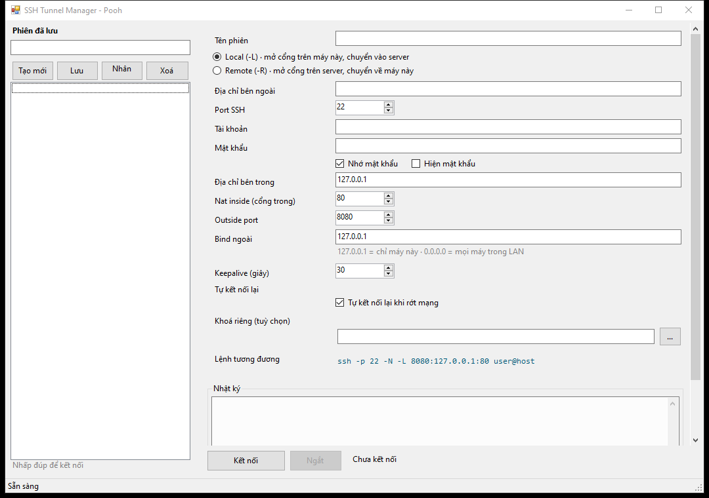
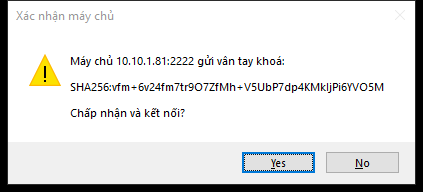
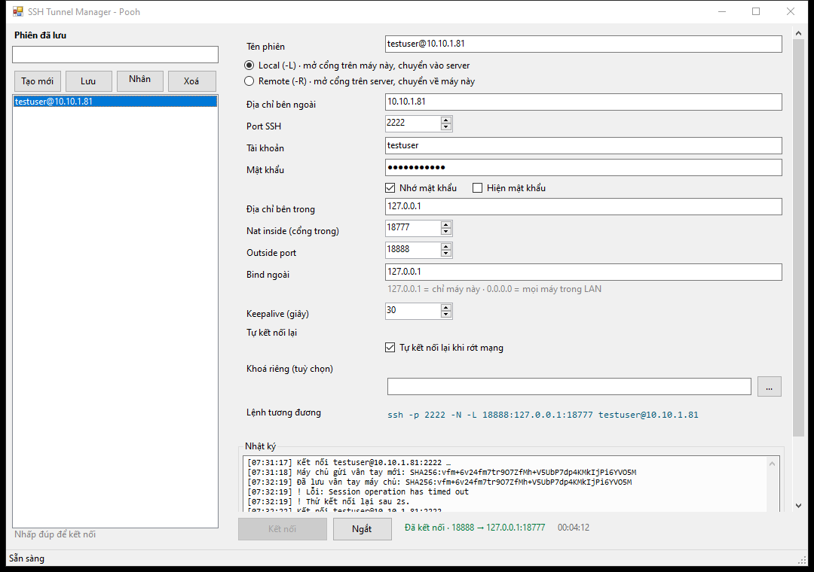

# SSH-VPN

A Windows desktop GUI for creating SSH tunnels — the same thing as running:

```bash
ssh -p 225 -N -L 18789:127.0.0.1:18789 openclaw@113.161.69.80
```

Built because typing that command every time is annoying, and because plain `ssh.exe` cannot accept a password non-interactively on Windows.



## What it does

- **Local forwarding (`-L`)** — open a port on this Windows machine, forward it to a host reachable from the SSH server.
- **Remote forwarding (`-R`)** — open a port on the SSH server, forward it back to this machine.
- **Remembers sessions** — saved profiles with names, searchable list, double-click to connect.
- **Remembers passwords** — encrypted with Windows DPAPI, bound to the current Windows account.
- **Asks to trust the host key** — same first-connection prompt as `ssh`, with SHA256 fingerprint. If the fingerprint changes later, the dialog turns red and refuses unless you explicitly tick a risk acknowledgement.
- **Auto-reconnect** — with exponential backoff up to 60s.
- **Keepalive** — default 30s.
- **Private key auth** — OpenSSH keys, with optional passphrase.
- **Port preflight** — detects Windows-reserved port ranges before connecting (see below).
- **Command line mode** — build a session and connect from a script.

## Screenshots

| Host key prompt | Connected |
|---|---|
|  |  |

## Requirements

- Windows 10 / 11 / Server 2016 or newer.
- **No .NET install needed** — the exe targets .NET Framework 4.8, which ships with Windows 10 1903+.
- No Python, no OpenSSH client, no `sshpass`.

Download the release exe, run it. SmartScreen will warn because the binary is unsigned: **More info → Run anyway**.

## Fields

| Field | Meaning | In the example command |
|---|---|---|
| Server address | SSH host IP or hostname | `113.161.69.80` |
| SSH port | SSH daemon port | `225` |
| Username | SSH login | `openclaw` |
| Password | SSH password (or leave blank and use a key) | — |
| Inside address | Target host as seen from the server side | `127.0.0.1` |
| Nat inside | Target service port | `18789` |
| Outside port | Port to open | `18789` |
| Outside bind | `127.0.0.1` = this machine only · `0.0.0.0` = whole LAN | `127.0.0.1` |

The blue line under the form always shows the equivalent `ssh` command, so you can verify what it will do.

## The "socket forbidden" error (WSAEACCES 10013)

If you ever see:

```
An attempt was made to access a socket in a way forbidden by its access permissions
```

**It is almost never a permissions problem.** On Windows the usual cause is that the port falls inside a range reserved by Hyper-V, WSL2, Docker Desktop or Windows NAT. Those ranges are blocked even for Administrator.

Check:

```powershell
netsh interface ipv4 show excludedportrange protocol=tcp
```

Release the ranges (PowerShell as Administrator):

```powershell
net stop winnat
net start winnat
```

Or simply let the app suggest a free port — it pre-checks the port before connecting and offers the nearest free one.

## Saved data locations

| What | Where |
|---|---|
| Sessions | `%APPDATA%\SshTunnelManager\sessions.json` |
| Window geometry | `%APPDATA%\SshTunnelManager\ui.json` |
| Error log | `%APPDATA%\SshTunnelManager\logs\yyyy-MM-dd.log` |
| Crash log | `%APPDATA%\SshTunnelManager\crash.log` |

Passwords in `sessions.json` are DPAPI blobs. Copying that file to another machine or another Windows user means the passwords cannot be decrypted — by design.

## Command line

```bat
SshTunnelManager.exe --host 113.161.69.80 --ssh-port 225 --user openclaw ^
  --password yourpassword --inside 127.0.0.1:18789 --outside 18789 --connect --remember
```

| Flag | Meaning |
|---|---|
| `--host` | SSH server |
| `--ssh-port` | SSH port (default 22) |
| `--user` | Username |
| `--password` | Password |
| `--inside host:port` | Target on the server side |
| `--outside` | Port to open |
| `--bind` | Bind address (default `127.0.0.1`) |
| `--remote` | Use `-R` instead of `-L` |
| `--connect` | Connect immediately after launch |
| `--remember` | Save the profile |

## Build from source

Requires the .NET SDK 8 or newer (the project targets `net48` but builds cross-platform):

```bash
cd src
dotnet build -c Release
```

Output: `src/bin/Release/net48/SshTunnelManager.exe` — a single self-contained exe thanks to Costura.Fody.

Dependencies: `SSH.NET 2025.0.0`, `Costura.Fody 5.7.0`.

## How it was tested

Tested on a real Windows 10 machine against a real OpenSSH server, not just compiled:

| Case | Result |
|---|---|
| Launch | OK |
| Host key prompt shown, accepted | Connected, fingerprint saved |
| Host key prompt declined | Aborted with a clear message |
| Local forward `-L` | HTTP 200 through the tunnel, body matches |
| Remote forward `-R` | HTTP 200 through the tunnel |
| Wrong password | Clear auth error, no crash |
| Windows reserved port | Preflight catches it before connecting |

Notable bugs found only by running on Windows (they never appear when only compiling on Linux):

1. `SplitContainer.Panel1MinSize` set in the constructor throws `InvalidOperationException` — the app crashed with `0xE0434352` on startup. Fixed by setting it in `Load`.
2. `BeginInvoke` before the window handle exists, when auto-connecting from the command line. Fixed by waiting for `Shown`.
3. The Connect/Disconnect buttons disappeared because of `Dock` ordering plus a `Percent(100)` row eating all the space. Fixed with a `TableLayoutPanel` and a docked action bar.

## Limitations

- Ports below 1024 need **Run as administrator**.
- `-R` depends on the server's `GatewayPorts` setting; OpenSSH binds to `127.0.0.1` by default.
- Binding `0.0.0.0` in local mode makes SSH.NET bind every IPv4 interface rather than a true wildcard — equivalent on a single-NIC machine.
- No SOCKS proxy (`-D`) and no ProxyJump (`-J`).
- If the SSH server has `AllowTcpForwarding no`, the session connects but no data flows. The app cannot detect this reliably; data simply fails on use.

## License

MIT — see [LICENSE](LICENSE).
